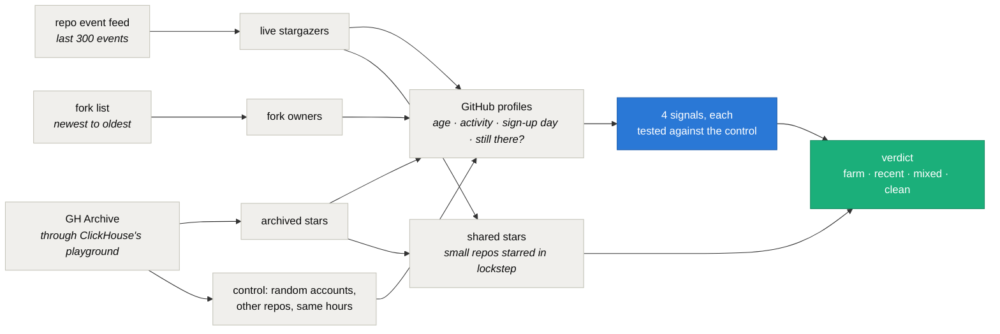

<div align="center">


# starsift — check whether a repo's stars come from real accounts

**In 2026 GitHub stopped showing who starred a repo to anyone but its admins and collaborators, and the fake-star checkers that read that list stopped working. starsift finds the same accounts through the repo's event feed, GH Archive and its forks, compares them with random accounts that were starring other repos in the same hours, and tells you whether a star farm is behind the count.**

[](https://pypi.org/project/starsift/)
[](https://github.com/intikhab49/starsift/blob/main/LICENSE)
[](https://www.python.org/)
[](https://github.com/intikhab49/starsift/blob/main/pyproject.toml)
[](https://github.com/intikhab49/starsift/actions/workflows/ci.yml)

[Quick start](#quick-start) · [Example](#example) · [How it works](#how-it-works) · [Validation](#validation) · [Limits](#limits) · [FAQ](#faq)

</div>

---

## The problem

Stars are how people pick a dependency, size up a startup or decide what to read, and that makes them worth faking. Star farms sell them by the thousand, and the CMU study credited below counted millions of suspected fake stars.

The usual check was to pull a repo's stargazers and look at the accounts. On June 30, 2026 GitHub [limited that list](https://github.blog/changelog/2026-06-30-upcoming-access-restrictions-to-public-api-endpoints-and-ui-views/) to the repo's admins and collaborators. For everyone else, `GET /repos/{owner}/{repo}/stargazers` now answers 404 on any repo that has stars, and the GraphQL `stargazers` connection comes back empty.

The star count alone can't settle it either. A real project can gain 200,000 stars in ten days, as the first example below did, while a farm can add stars slowly enough that no spike ever shows.

## Quick start

```sh
pipx install starsift          # or: pip install starsift
starsift owner/repo
```

starsift needs a GitHub token for its GraphQL lookups. Any token works and none of its scopes are used. It reads `GITHUB_TOKEN` or `GH_TOKEN`, then falls back to a logged-in [GitHub CLI](https://cli.github.com/). A run takes 10 to 70 seconds and has no dependencies beyond Python 3.10 or newer.

| Option | What it does |
| --- | --- |
| `--sample N` | accounts per sample, 30 to 1000 (default 200) |
| `--control OWNER/NAME` | compare live stargazers and fork owners with this repo's instead of random accounts |
| `--no-archive` | skip the public GH Archive mirror |
| `--json` | print the result as JSON |

Exit status: 1 for a farm signature in the repo's history, 2 for an error, otherwise 0. Progress goes to stderr, so `--json` output can be piped.

## Example

A repo that gained 200,000 stars in ten days, checked on 2026-10-14:

```text
starsift 0.1.0  morluto/rea  218,439 stars  54,006 forks
stars per day, last 30 days  ▁▁▁▁▁▁▁▁▁▁▁▁▁▁▁▁▁▁▁▁▁▂▂▂▄▅▅██▃  busiest week (from Oct 8) brought 93% of all stars

                                       live stargazers       archived stars          fork owners
                                       repo    control      repo    control      repo    control
accounts checked                        196         99       200        200       148        148
account under 30 days old                6%         8%        3%         6%        2%        11%
older account with zero activity        12%        13%       13%        13%        8%        15%
older account from a same-day batch      0%         0%        0%         0%        0%         0%
account deleted or suspended since       0%         1%        0%         3%         -          -
sampled from                                last 8 min       Oct 3 - Oct 14      Oct 11 - Oct 14

Shared stars, 50 stargazers from the repo's history: none; their latest stars do not cluster on a small repo.
Shared stars, 50 recent stargazers: none; their latest stars do not cluster on a small repo.

Verdict: no farm signature.
  The accounts behind these stars look like ordinary GitHub users next to the control group.

Control: random accounts that starred or forked other repos in the same hours.
Limits: only the sampled windows are checked, and GitHub hides activity from accounts it has flagged.
```

A repo from a published dataset of suspected fake stars, names withheld. GitHub has since removed all but one of its stars; the archive still holds 1,279 star events:

```text
starsift 0.1.0  owner/repo  1 star  0 forks

                                        archived stars
                                       repo    control
accounts checked                        200        200
account under 30 days old                0%         3%
older account with zero activity         0%         5%
older account from a same-day batch      0%         0%
account deleted or suspended since      34%!       10%
sampled from                                  Oct 2024

Shared stars, 64 stargazers from the repo's history: small repos many of them starred recently
   30%  <small repo 1> (4,592 stars)
   25%  <small repo 2> (1,956 stars)
   17%  <small repo 3> (214 stars)
   17%  <small repo 4> (855 stars)
   16%  <small repo 5> (2,499 stars)

Verdict: farm signature.
  archived stars: 34% of accounts have been deleted or suspended since, against 10% of the control (p < 0.001).
  5 small repos are each starred by 16% to 30% of the same stargazers from the repo's history, the pattern a star farm leaves.

Control: random accounts that starred or forked other repos in the same hours.
Skipped: live stargazers (none found), fork owners (none found); a sample needs 30 accounts.
Limits: only the sampled windows are checked, and GitHub hides activity from accounts it has flagged.
```

The accounts that starred it in October 2024 are still starring the same handful of small repos two years later.

## How it works



**Three samples of accounts.**

- *Live stargazers*: star events in the repo's public event feed, which keeps the last 300 events of any kind.
- *Archived stars*: a random sample of the repo's star events in [GH Archive](https://www.gharchive.org/), read through [ClickHouse's public playground](https://play.clickhouse.com/). The archive caught almost every star until early 2025. Since mid-2026 it catches a few percent, which still gives a spread of stars across the repo's life.
- *Fork owners*: personal accounts that forked the repo, read at four points from newest to oldest.

**A control for each sample.** For every account, starsift draws a random account that starred (or forked) a different repo in the same hour, from the same archive. Without the archive it falls back to the live stargazers and fork owners of `--control` (default `ollama/ollama`).

**Four signals**, each compared with the control by a one-sided two-proportion z-test. A signal is flagged at p < 0.01 when it also rises by at least the gap below.

| Signal | Meaning | Flag at | Decides alone at |
| --- | --- | --- | --- |
| account under 30 days old | measured at the moment it starred or forked | +10 points | never |
| older account with zero activity | 30+ days old; no followers, follows nobody, no original repos or gists | +10 points | never |
| older account from a same-day batch | 30+ days old; created on a day shared by 3+ accounts and 2% of the sample | +10 points | +30 points |
| account deleted or suspended since | the login no longer resolves, or now belongs to an account created after the star | +5 points | +30 points |

New and inactive accounts never decide alone, because a real audience can produce them: a game mod draws players who sign up just to download it. Mass deletions and batch-registered accounts have no organic explanation.

**Shared stars.** starsift reads the six latest stars of up to 100 stargazers, half recent and half from the archive. A repo under 5,000 stars that 15% or more of either half starred is the lockstep pattern a star farm leaves.

**Verdict.** A sample is farm-like when it shows two different signals, shared stars plus one signal, or one signal past its "decides alone" gap.

- *farm signature*: the archived stars or fork owners, which span the repo's whole life, are farm-like.
- *recent farm activity*: only the live stargazers are. Farms star popular repos to make their accounts look real, so this alone does not mean the repo bought stars.
- *mixed signals*: a signal or shared stars, but nothing farm-like.
- *no farm signature*: nothing stands out.
- *not enough data*: no sample reached 30 accounts.

## Validation

The StarScout study published the repos it suspected of fake stars, plus a random sample of 10,000 starred repos. Two random draws from that data, checked on 2026-10-14:

| Set | Repos | farm signature | recent farm activity | mixed signals | no farm signature | not enough data |
| --- | --- | --- | --- | --- | --- | --- |
| Suspected by the study (half or more of their stars, 150+ stars, still on GitHub) | 25 | 21 | 0 | 0 | 0 | 4 |
| Not suspected (random sample, 200+ stars) | 25 | 0 | 1 | 1 | 23 | 0 |


Deleted accounts separate the two sets on their own: every suspected repo sits at least 13 points above its control, and no unsuspected repo more than 4.5 above.

The four without enough data had too few star events in the archive to sample. The two unsuspected repos that were not clean are large projects with clean histories whose newest stargazers included brand-new or batch-registered accounts, which fits farms using popular repos as cover.

The study's labels are suspicions, not ground truth, so this measures agreement, not accuracy. In an earlier hand-picked set, starsift disagreed on two suspected repos: viral AI projects whose stargazers looked healthier than the control and had not been deleted at unusual rates. The study's authors warn that their dataset contains false positives and ask that it not be used to name individual repos, so none are named here.

To re-run it, `python tools/validate.py` draws the same sets from the study's data (as long as the same repos still exist), runs starsift on each and writes only the counts to [`docs/validation.json`](https://github.com/intikhab49/starsift/blob/main/docs/validation.json). It takes about 30 minutes.

## Limits

- Only the sampled windows are checked. A campaign outside them can slip through.
- Samples are random, so a borderline repo can come back mixed on one run and recent on the next.
- GitHub hides activity from accounts it has flagged, so some fake stars never appear in any sample.
- A farm of aged, active accounts that star nothing else in common looks like real users.
- The archive is a public demo server. When it is slow or down, starsift carries on without it.
- Star events filed under a repo's old name are missed after a rename.
- Shared stars name other repos. Farms also star random repos to look real, so a repo on that list may be a bystander. Treat it as a lead, not proof.
- A verdict is evidence, not proof.

## FAQ

**Does a farm signature prove the owner bought stars?**
No. It shows that a share of the accounts behind the stars look like a farm's next to ordinary stargazers from the same hours. Farms also star repos they were never paid for, to make their accounts look real.

**Why does my popular repo show recent farm activity?**
Because farms star popular repos as cover. When the signature appears only among the newest stargazers and the repo's history is clean, the repo is more likely the cover than the customer.

**Why not just look at the star-history chart?**
Spikes happen to real projects too. The first example gained 200,000 stars in ten days from accounts that look ordinary, while farms can add a few stars a day for years. The accounts say more than the curve.

**How much of my GitHub API quota does a run use?**
Very little. Two full runs used under 10 of the 5,000 points a token gets each hour.

**Can I still see who starred my own repo?**
Yes. Admins and collaborators still see the list on GitHub. starsift samples other sources so it works on anyone's repo.

**Does it work on private repos?**
No. Its samples and its control come from public star and fork events.

## Credits

The low-activity and lockstep signals follow [StarScout](https://github.com/hehao98/StarScout): Hao He, Haoqin Yang, Philipp Burckhardt, Alexandros Kapravelos, Bogdan Vasilescu and Christian Kästner, *Six Million (Suspected) Fake Stars on GitHub: A Growing Spiral of Popularity Contests, Spam, and Malware*, ICSE 2026. Star events come from GH Archive through ClickHouse's public playground, and star history from [OSS Insight](https://ossinsight.io/).

## License

MIT
